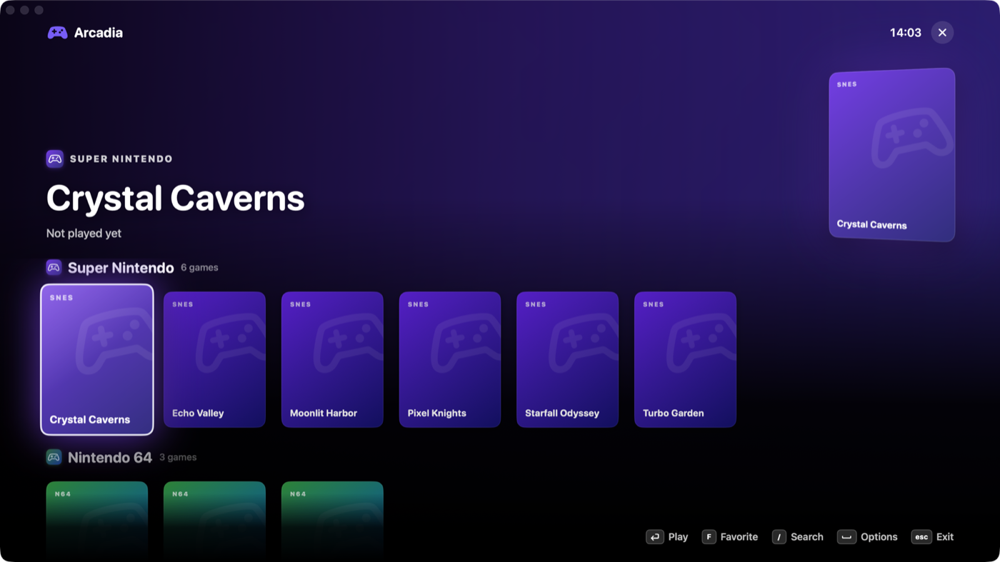
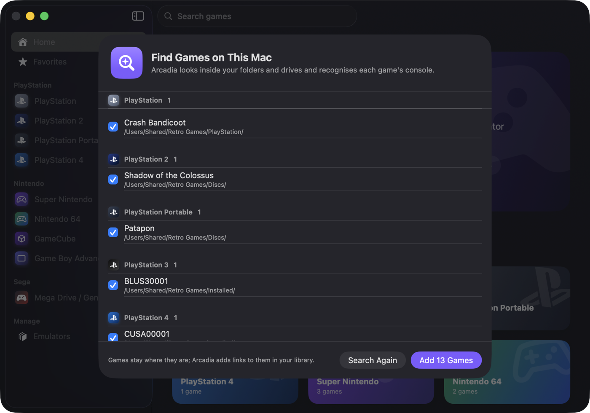

# Arcadia

A beautiful, native macOS home for all your games, from the Atari 2600 to the PlayStation 5.

Arcadia is a SwiftUI frontend: it installs the best open-source emulator for each system,
scans your game folders, shows box art and starts games with a double-click.


> Status: early development. PS4 and especially PS5 emulation are experimental upstream.
>
> Arcadia runs on **Macs with Apple silicon (M1 or later) and macOS 26 or later**. Every emulator
> runs natively except shadPS4 (PS4), SharpEmu (PS5) and Cemu (Wii U), which only ship Intel
> builds; for those Arcadia offers to install Rosetta 2 the first time.

## Features

- **One library for every system**: a folder per console, games grouped by maker in the sidebar
- **Emulators installed for you** from each project's official releases, with one-click updates
- **Zero emulator setup**: Arcadia writes tuned settings for every emulator before each launch
  (Metal or Vulkan renderer, resolution matched to your Mac's GPU, no first-run wizards or update
  prompts, BIOS folders, gamepad mappings). One "Graphics quality" setting covers them all
- **Any controller just works**: right before a game starts Arcadia reads the connected
  controllers through SDL, exactly as the emulators see them, and maps up to four of them to
  players 1–4, including emulators that need the device's exact name or GUID (Dolphin, Cemu,
  RPCS3, melonDS)
- **Select + Start** on a gamepad quits back to Arcadia in most emulators
- **TV Mode** (⇧⌘T): a full-screen, controller-first interface with big box art, a Continue
  Playing shelf, favorites and a shelf for every console; it can open by itself when a
  controller connects
- **Game details**: box art, screenshots, genre, developer, publisher, release year, player count
  and a Wikipedia description in your language, from open sources with no accounts or API keys
- **Collections, sorting and filters**: your own collections in the sidebar; sort any grid by
  name, recently played, most played, recently added or year, and filter by genre, decade or players
- **Find Games on This Mac**: searches your home folder and drives, recognises each game's console
  from the disc or ROM itself (not just the file name) and adds it in place, without copying
- **Live library**: games copied into the library folder show up right away; drag and drop onto a
  console page works too
- **Save Disk Space**: lossless compression of PSP and PS2 ISOs to CSO and GameCube ISOs to GCZ,
  checked against the original before the original goes to the Trash
- **iCloud Drive save sync**: saves, save states and memory cards follow you to your other Macs;
  differing saves keep the newer copy and back up the other
- **RetroAchievements**: sign in once and earn achievements in RetroArch, DuckStation, PPSSPP,
  Dolphin and Flycast, with optional hardcore mode; only a token is kept in your Keychain
- **Works with your Mac**: games in Spotlight, "Play … in Arcadia" with Siri and Shortcuts, and a
  Continue Playing widget
- **Launch logs**: each launch's emulator output is kept in `~/Library/Logs/Arcadia`; if a game
  closes right after starting, the alert offers its log
- **Updates**: Arcadia updates itself with Sparkle (Arcadia › Check for Updates…), and installed
  emulators are checked daily and updated in the background, never while you're playing
- Favorites, recently played, play time and search
- Available in English, Türkçe, 简体中文, Español, हिन्दी, العربية, Français and Português (Brasil)






## Installing

Download the latest `Arcadia-<version>.dmg` from [Releases](https://github.com/akkanferhan/arcadia/releases),
open it and drag Arcadia to Applications. Releases are signed with a Developer ID and notarized by Apple.

## Supported systems

| Maker | Systems | Emulator |
| --- | --- | --- |
| PlayStation | PS1 | DuckStation |
| | PS2 | RetroArch (PCSX2 core, native arm64) |
| | PSP | PPSSPP |
| | PS3 | RPCS3 |
| | PS4 | shadPS4 (experimental, Rosetta) |
| | PS5 | SharpEmu (experimental, Rosetta) |
| Nintendo | NES, SNES, N64, Game Boy, Game Boy Color, Game Boy Advance | RetroArch (Mesen, Snes9x, Mupen64Plus-Next, Gambatte, mGBA) |
| | GameCube, Wii | Dolphin |
| | Wii U | Cemu (Rosetta) |
| | Nintendo DS | melonDS |
| | Nintendo 3DS | Azahar |
| Sega | Master System, Mega Drive, Game Gear | RetroArch (Genesis Plus GX) |
| | Saturn | RetroArch (Beetle Saturn) |
| | Dreamcast | Flycast |
| Microsoft | Xbox | xemu |
| Classics | Atari 2600, PC Engine, Arcade | RetroArch (Stella, Beetle PCE Fast, FinalBurn Neo) |

## Games and BIOS files

Arcadia never ships games, BIOS or firmware: they are copyrighted by the console makers.
Use dumps of games and hardware you own. On first launch Arcadia creates this layout in the folder
you choose (default `~/Games`):

```
Games/
├─ snes/  ps2/  gc/  ...      one folder per system; files can also sit one folder deeper
├─ ps3/  ps4/  ps5/           installed game folders (PS4/PS5: folder with eboot.bin)
└─ bios/
   ├─ ps1/  ps2/  ps3/  xbox/
   └─ (RetroArch BIOS files go in bios/ directly)
```

Drop BIOS files on the **BIOS & System Software** card on the Emulators page and Arcadia sorts
them into place. Most systems need no BIOS at all:

| System | Without your BIOS |
| --- | --- |
| PS1 | Plays through PCSX ReARMed's built-in BIOS; DuckStation takes over once you add one |
| Saturn | Plays through Yabause's built-in BIOS (multi-disc games need the real one) |
| PS3 | System software is downloaded from Sony's update servers on first play |
| PS2, Xbox | Your console's BIOS is required; there is no free replacement |

Multi-disc games: add an `.m3u` playlist and Arcadia hides the individual discs.

## Building

Requirements: a Mac with Apple silicon, macOS 26 or later, Xcode 26 or later.

```sh
open Arcadia.xcodeproj
```

The Xcode project is generated from `project.yml` with [XcodeGen](https://github.com/yonaskolb/XcodeGen).
After changing `project.yml` or adding files, run `xcodegen generate`.

Arcadia keeps emulators, box art and play history in `~/Library/Application Support/Arcadia`.

### Tests

```sh
xcodebuild -project Arcadia.xcodeproj -scheme Arcadia test
```

### Emulator presets

Each emulator's tuned settings live in `Arcadia/Services/Presets/`. They are written right before
every launch and only touch the keys Arcadia manages. Where an emulator supports it, Arcadia keeps
its settings and saves in `~/Library/Application Support/Arcadia/Data/<emulator>` so a separately
installed copy of the emulator is not affected.

### Translations

All user-facing text lives in `Arcadia/Resources/Localizable.xcstrings`. Xcode adds new strings to the
catalog when you build; translate them in Xcode's String Catalog editor. To preview a language, run with
`-AppleLanguages "(tr)"` in the scheme's arguments.

## Releasing

1. Update `MARKETING_VERSION` in `project.yml` (then `xcodegen generate`) and the `CHANGELOG.md` section.
2. Merge `develop` into `main`, tag it (`git tag v0.1.0`) and push the tag.
3. The **Release** workflow builds, signs, notarizes and staples `Arcadia-<version>.dmg`, publishes it
   with a signed Sparkle `appcast.xml`, and installed copies of Arcadia offer the update.

The workflow needs these repository secrets:

| Secret | Value |
| --- | --- |
| `DEVELOPER_ID_P12` | The *Developer ID Application* certificate and key, exported as .p12, base64-encoded |
| `DEVELOPER_ID_P12_PASSWORD` | The .p12 password |
| `NOTARY_API_KEY` | An App Store Connect API key (.p8), base64-encoded |
| `NOTARY_KEY_ID`, `NOTARY_ISSUER` | That key's ID and issuer ID |
| `SPARKLE_PRIVATE_KEY` | The Sparkle EdDSA private key that signs `appcast.xml` (export it with `generate_keys -x`) |

To build a release locally, save notarization credentials once with
`xcrun notarytool store-credentials arcadia-notary --apple-id <id> --team-id 43THU6L26P`, then run
`NOTARY_PROFILE=arcadia-notary scripts/release.sh`.

## Project layout

```
Arcadia/
├─ App/        app entry point and shared state
├─ Models/     systems, emulators and games catalog
├─ Services/   installer, library scanner, game finder, launcher, box art, presets
└─ Views/      SwiftUI screens and components
Tests/         unit tests (Swift Testing)
Vendor/        SDL 3 (arm64)
scripts/       release build
```

## Contributing

- `main`: releases only
- `develop`: integration branch
- `feature/*`: one branch per piece of work, merged into `develop`

Commits follow [Conventional Commits](https://www.conventionalcommits.org) (`feat:`, `fix:`, `chore:`).

## Legal

Arcadia is not affiliated with, endorsed or sponsored by Sony Interactive Entertainment, Nintendo,
Sega, Microsoft or any other console maker. PlayStation, Nintendo, Sega, Xbox and the names of their
consoles are trademarks of their respective owners and are used here only to identify the systems
Arcadia supports. Arcadia does not include or download games, BIOS files or firmware, other than
system software the console maker itself publishes for download. Only use games and BIOS files you
have dumped from hardware and media you own.

## License

Arcadia is licensed under the [GNU General Public License v3.0](LICENSE).
It bundles [SDL 3](https://libsdl.org) (`Vendor/SDL3.framework`, arm64 only) under the
[zlib license](Vendor/SDL3-LICENSE.txt) to read connected controllers.
Emulators are separate projects under their own licenses and are downloaded from their official sources.
