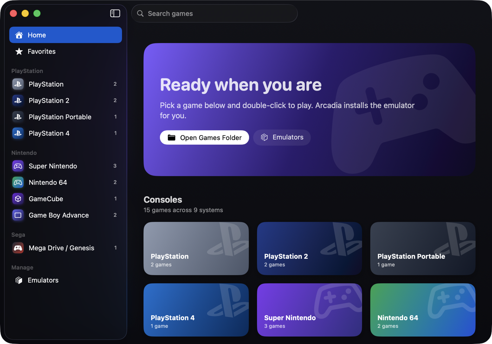
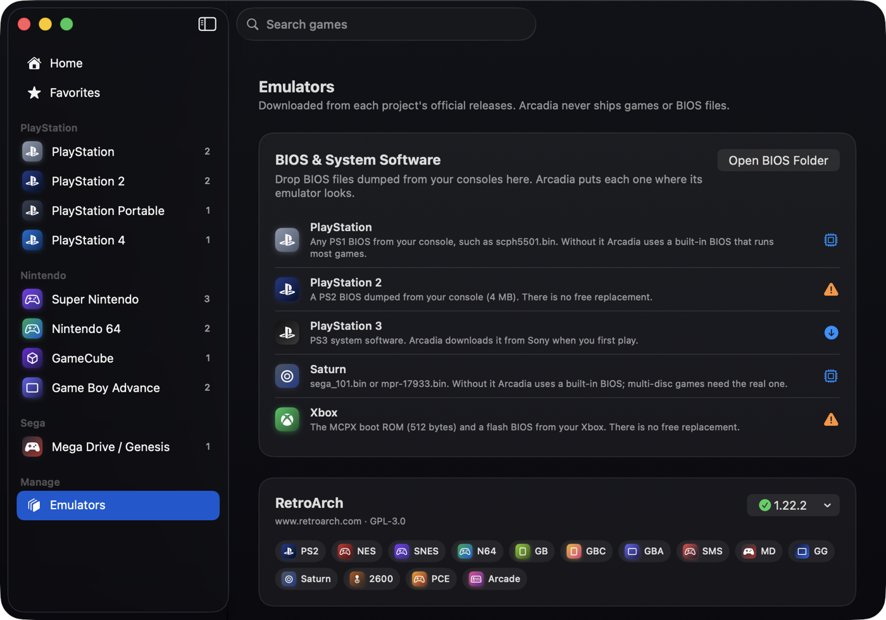

# Arcadia

A beautiful, native macOS home for all your games, from the Atari 2600 to the PlayStation 5.

Arcadia is a SwiftUI frontend: it installs the best open-source emulator for each system,
scans your game folders, shows box art and starts games with a double-click.



> Status: early development. PS4 and especially PS5 emulation are experimental upstream.
>
> Arcadia runs on **Macs with Apple silicon (M1 or later)** only. PCSX2, shadPS4, Cemu and SharpEmu
> only ship Intel builds for macOS; they run through Rosetta 2, which macOS offers to install the
> first time. RPCS3 needs macOS 15 or later.

## Features

- **One library for every system**: a folder per console, games grouped by maker in the sidebar
- **Emulators installed for you** from each project's official releases, with one-click updates
- **Zero emulator setup**: Arcadia writes tuned settings for every emulator before each launch
  (Metal or Vulkan renderer, resolution matched to your Mac's GPU, no first-run wizards or update
  prompts, BIOS folders, gamepad mappings). One "Graphics quality" setting covers them all
- **Select + Start** on a gamepad quits back to Arcadia in most emulators
- **Box art** from your PS3/PS4/PS5 game folders or [libretro-thumbnails](https://github.com/libretro-thumbnails)
- **Drag and drop** games onto a console page to add them
- Favorites, recently played, play time and search
- Full screen by default; quit a game from Arcadia's now-playing bar
- Available in English, Türkçe, 简体中文, Español, हिन्दी, العربية, Français and Português (Brasil)



## Supported systems

| Maker | Systems | Emulator |
| --- | --- | --- |
| PlayStation | PS1 | DuckStation |
| | PS2 | PCSX2 |
| | PSP | PPSSPP |
| | PS3 | RPCS3 |
| | PS4 | shadPS4 (experimental) |
| | PS5 | SharpEmu (experimental, Rosetta) |
| Nintendo | NES, SNES, N64, Game Boy, Game Boy Color, Game Boy Advance | RetroArch (Mesen, Snes9x, Mupen64Plus-Next, Gambatte, mGBA) |
| | GameCube, Wii | Dolphin |
| | Wii U | Cemu (Rosetta) |
| | Nintendo DS | melonDS |
| | Nintendo 3DS | Azahar |
| Sega | Master System, Mega Drive, Game Gear | RetroArch (Genesis Plus GX) |
| | Saturn | RetroArch (Beetle Saturn) |
| | Dreamcast | Flycast |
| Microsoft | Xbox | xemu |
| Classics | Atari 2600, PC Engine, Arcade | RetroArch (Stella, Beetle PCE Fast, FinalBurn Neo) |

## Games and BIOS files

Arcadia never ships games, BIOS or firmware: they are copyrighted by the console makers.
Use dumps of games and hardware you own. On first launch Arcadia creates this layout in the folder
you choose (default `~/Games`):

```
Games/
├─ snes/  ps2/  gc/  ...      one folder per system; files can also sit one folder deeper
├─ ps3/  ps4/  ps5/           installed game folders (PS4/PS5: folder with eboot.bin)
└─ bios/
   ├─ ps1/  ps2/  ps3/  xbox/
   └─ (RetroArch BIOS files go in bios/ directly)
```

Drop BIOS files on the **BIOS & System Software** card on the Emulators page and Arcadia sorts
them into place. Most systems need no BIOS at all:

| System | Without your BIOS |
| --- | --- |
| PS1 | Plays through PCSX ReARMed's built-in BIOS; DuckStation takes over once you add one |
| Saturn | Plays through Yabause's built-in BIOS (multi-disc games need the real one) |
| PS3 | System software is downloaded from Sony's update servers on first play |
| PS2, Xbox | Your console's BIOS is required; there is no free replacement |

Multi-disc games: add an `.m3u` playlist and Arcadia hides the individual discs.

## Building

Requirements: a Mac with Apple silicon, macOS 14 or later, Xcode 16 or later.

```sh
open Arcadia.xcodeproj
```

The Xcode project is generated from `project.yml` with [XcodeGen](https://github.com/yonaskolb/XcodeGen).
After changing `project.yml` or adding files, run `xcodegen generate`.

Arcadia keeps emulators, box art and play history in `~/Library/Application Support/Arcadia`.

### Emulator presets

Each emulator's tuned settings live in `Arcadia/Services/Presets/`. They are written right before
every launch and only touch the keys Arcadia manages. Where an emulator supports it, Arcadia keeps
its settings and saves in `~/Library/Application Support/Arcadia/Data/<emulator>` so a separately
installed copy of the emulator is not affected.

### Translations

All user-facing text lives in `Arcadia/Resources/Localizable.xcstrings`. Xcode adds new strings to the
catalog when you build; translate them in Xcode's String Catalog editor. To preview a language, run with
`-AppleLanguages "(tr)"` in the scheme's arguments.

## Project layout

```
Arcadia/
├─ App/        app entry point and shared state
├─ Models/     systems, emulators and games catalog
├─ Services/   installer, library scanner, launcher, box art
└─ Views/      SwiftUI screens and components
```

## Contributing

- `main`: releases only
- `develop`: integration branch
- `feature/*`: one branch per piece of work, merged into `develop`

Commits follow [Conventional Commits](https://www.conventionalcommits.org) (`feat:`, `fix:`, `chore:`).

## License

Arcadia is licensed under the [GNU General Public License v3.0](LICENSE).
Emulators are separate projects under their own licenses and are downloaded from their official sources.
